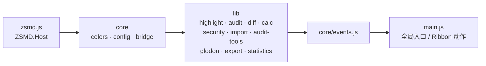

# JS 架构

::: warning 本页建设中
架构正文待补齐；以下模块加载顺序已按 `wps-js-plugin/build.js` 的 `ORDER` 核对，可先作为阅读地图。
:::

## 模块加载顺序（16 个文件）

> `ORDER` 是唯一权威加载顺序；构建产物 `dist/zsmd-all.js` 与 Node 测试注入均按此顺序执行。

## 设计原则

- `ZSMD.Host` 是核心服务访问宿主对象（`wps`）的唯一通道，因此纯逻辑可在 Node 用 stub 完整测试。
- 已知例外：`security.js`、`import.js`、`audit-tools.js`、`export.js`、`main.js` 直接触碰宿主，其真机路径不可单测。

## 写作清单

- ☐ 命名空间与模块职责总表
- ☐ `build.js` 的 ORDER 与产物同步机制
- ☐ 宿主边界与可测性设计（延伸：[宿主适配层](/dev/host-adapter.html)）
- ☐ 与 VBA 分层的对照（延伸：[VBA 架构](/dev/architecture-vba.html)）
