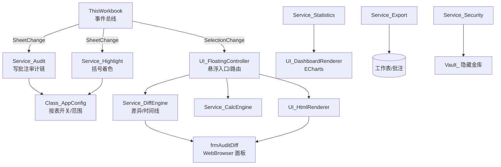

# VBA 架构

::: warning 先分清两份 VBA 源码
仓库里有两份 VBA：`src/`（人工转写副本，存在已知退化）与 `src-xlsm-v4.67/`（从真机 v4.67 工作簿抽取、可编译的基线）。
**重建部署文件请以 `src-xlsm-v4.67/` 为准**；`src/` 只适合当阅读材料（例如 `ThisWorkbook` 的事件签名不完整，直接回导会导致事件总线静默失效）。
:::

## 运行形态

VBA 版是一个**启用宏的 xlsm 工作簿**：代码随文件走，靠工作簿事件驱动，UI 由功能区 + 用户窗体 + 工作表按钮组成。最后一个制品是 **v4.66**（`releases/`），现已冻结。

## 30 个模块怎么分工

| 层 | 模块 | 职责 |
| --- | --- | --- |
| **入口** | `ThisWorkbook` | 事件总线：`Workbook_SheetChange` / `SheetSelectionChange` 等 |
| | `基础设置` | 配置表生成、宏注册、控制台按钮、配置同步 |
| | `测试模块` | 真机联调自测（真机基线独有） |
| **Layer 1–2 状态** | `Class_AppConfig` | 全局参数容器、惰性加载、按表开关 |
| | `Class_AppColor` | 主题色/括号配色、吸色逻辑 |
| | `Mod_AppFactory` | 全局单例（依赖注入入口） |
| **Layer 3 服务** | `Service_Audit` | 变更拦截、批注审计链、快照 |
| | `Service_AuditTools` | 清除审计标记等 |
| | `Service_CalcEngine` | 算式清洗 + 求值 |
| | `Service_DiffEngine` | 字符级 LCS 差异与时间线 HTML |
| | `Service_Highlight` | 括号层级着色 |
| | `Service_Import` | 旧表导入与配置继承 |
| | `Service_Export` | 审查版/交付版导出 |
| | `Service_Security` | 隐私金库加解密 |
| | `Service_Statistics` | 批注聚合与指标 |
| **Layer 4 视图** | `UI_HtmlRenderer` | HTML 片段/组件化渲染 |
| | `UI_DashboardRenderer` | ECharts 大屏页面 |
| | `UI_FloatingController` | 悬浮按钮/面板路由、WebBrowser 喂 HTML |
| **用户窗体** | `frmAuditDiff` / `frmReadingMode` / `frmImport` / `frmPrivacy` | 时间线、阅读、导入、隐私批处理 |
| **工作表** | `Sheet1`～`Sheet8` | 业务表事件与薄封装 |

## 运行时数据流

要点：

- **写路径**：`SheetChange` → 配置/隐私/批量校验 → 审计（单格）与变色（范围）；
- **读路径**：`SelectionChange` → 悬浮控制器 → 需要时调用差异/计算/渲染，把 HTML 推进无模式窗体；
- **报表路径**：`Service_Statistics` 聚合批注 → `UI_DashboardRenderer` 生成大屏 HTML。

## 与 JS 版的模块对应

| VBA | WPS JS | 说明 |
| --- | --- | --- |
| `Class_AppConfig` + `基础设置` | `js/core/config.js` | 配置引擎 + 模板生成 |
| `Class_AppColor` | `js/core/colors.js` | 颜色读取 |
| `Service_Audit` | `js/lib/audit.js` | 审计链与快照栈 |
| `Service_Highlight` | `js/lib/highlight.js` | 着色引擎 |
| `Service_DiffEngine` + `UI_HtmlRenderer` | `js/lib/diff.js` | 差异 + 阅读渲染 |
| `Service_CalcEngine` | `js/lib/calc.js` | 求值器（不再依赖宿主 Eval） |
| `Service_Security` | `js/lib/security.js` | 金库加解密 |
| `Service_Import` / `Service_Export` | `js/lib/import.js` / `export.js` | 导入导出 |
| `Service_Statistics` + `UI_DashboardRenderer` | `js/lib/statistics.js` | 统计与大屏 |
| `UI_FloatingController` | `js/main.js` + 侧边栏 | 悬浮窗改为 Ribbon/任务窗格 |

## 回导 VBE（重建工作簿时）

1. 打开目标工作簿 → `Alt+F11`；
2. 删除同名旧模块，或「文件 → 导入文件」覆盖；
3. 逐个导入 `src-xlsm-v4.67/` 的 `.bas` / `.cls` / `.frm`；
4. 「调试 → 编译 VBAProject」确认 0 错误；
5. 检查 `ThisWorkbook` 的 `Workbook_SheetChange` 是否保留 `(Sh As Object, Target As Range)` 两个参数——`src/` 的版本缺参数，是最容易踩的坑。

::: tip 关于 .frx
真机基线不含窗体二进制（`.frx`），导入后窗体外观可能异常；在 VBE 里对窗体右键「导出文件」可补出成对的 `.frm` + `.frx`。
:::

## 已知边界

- `src/` 与真机有 14 个模块存在真实代码差异（非注释差异），不要混用；
- `src/` 里的 `Mod_ShortcutManager`、`Service_GlodonCleaner` 在真机 v4.67 中不存在；
- VBA 线已冻结，新功能只在 [JS 版](/dev/architecture-js.html)迭代；两者能力对照见[双实现能力矩阵](/dev/parity.html)。

## 相关源码

- 真机基线：`src-xlsm-v4.67/`（含 README 的逐模块比对结论）
- 阅读副本：`src/`（仅参考，不用于重建）
- 发布制品：`releases/智算墨斗v4.66.xlsm`
