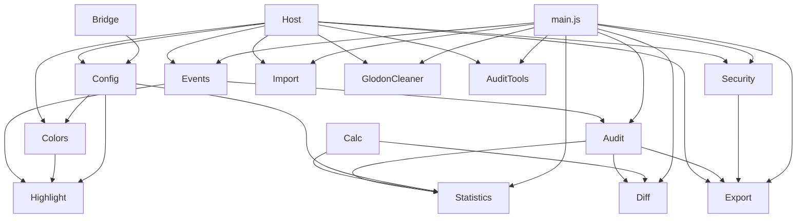

# 模块参考索引

模块页统一结构：**职责 → 导出 API → 调用关系 → 测试覆盖 → 源码**。
API 以源码为准；文档只列常用入口，避免与代码漂移。

## 模块地图

| 层 | 模块 | 职责 |
| --- | --- | --- |
| 宿主 | [Host](/dev/module-ref/host.html) | 唯一接触 `wps`/`Application` 的适配层 |
| core | [Colors](/dev/module-ref/colors.html) | 主题色/括号配色 |
| core | [Config](/dev/module-ref/config.html) | 参数树、配置表、按表开关、锁定 |
| core | [Bridge](/dev/module-ref/bridge.html) | 工作簿解析、启用判定、配置表注入 |
| core | [Events](/dev/module-ref/events.html) | 事件注册、路由、表结构同步 |
| lib | [Audit](/dev/module-ref/audit.html) | 审计链、批注铁律、快照 |
| lib | [Highlight](/dev/module-ref/highlight.html) | 括号层级着色 |
| lib | [Diff](/dev/module-ref/diff.html) | LCS 差异、时间线、阅读渲染 |
| lib | [Calc](/dev/module-ref/calc.html) | 纯 JS 求值器 |
| lib | [Security](/dev/module-ref/security.html) | 隐私金库与批量处理 |
| lib | [Import](/dev/module-ref/import.html) | 旧表导入与配置继承 |
| lib | [Export](/dev/module-ref/export.html) | 审查版/交付版导出 |
| lib | [GlodonCleaner](/dev/module-ref/glodon.html) | 导出表清洗 |
| lib | [Statistics](/dev/module-ref/statistics.html) | 批注聚合与大屏 |
| lib | [AuditTools](/dev/module-ref/audit-tools.html) | 清除审计标记 |
| 入口 | [main](/dev/module-ref/main.html) | 全局函数、Ribbon 动作、面板 |

## 依赖关系（简化）

> 箭头表示"依赖/调用"，实际加载顺序由 `build.js` 的 `ORDER` 决定（16 个文件），见[构建与测试](/dev/build-test.html)。

## 阅读顺序建议

| 目的 | 顺序 |
| --- | --- |
| 理解整体 | Host → Config → Events → Audit → Diff |
| 改渲染/UI | Colors → Highlight → Diff → Statistics |
| 改数据进出 | Import → Export → Security → AuditTools |
| 加新功能 | Host（如需宿主）→ 新 lib 模块 → main.js 绑定 → 测试 |

## 测试映射

每个模块页都标注了对应测试套件；总览见[构建与测试](/dev/build-test.html)。
